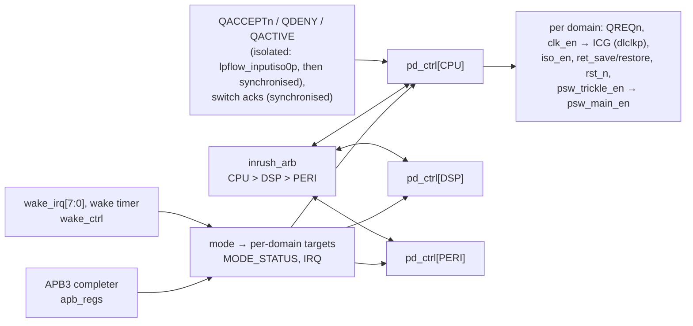
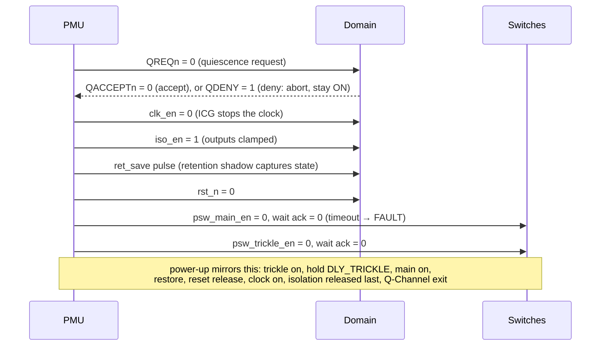
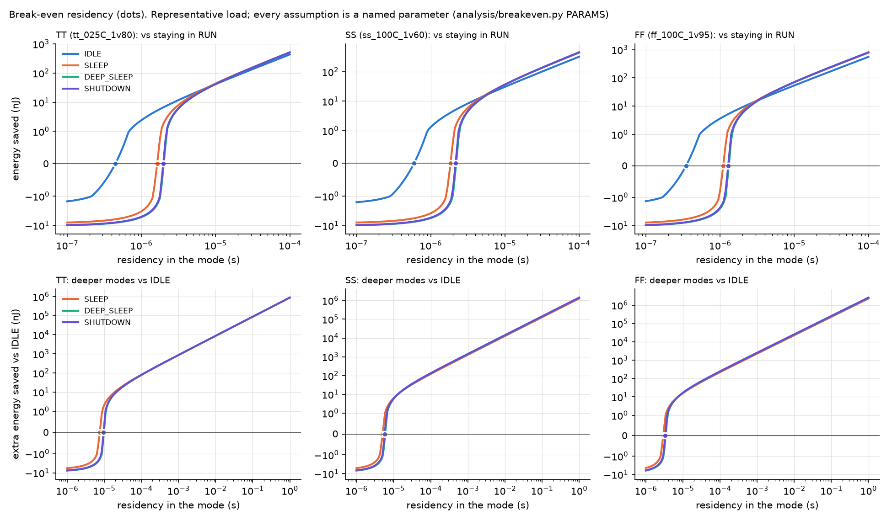

# soc-pmu-sequencer

A formally verified multi-domain **power-management unit** for an SoC, in SystemVerilog, taken to
layout on SkyWater SKY130 with open-source tools.
- **What it controls:** three switchable power domains (CPU and DSP with retention, PERI without),
  driven over an **APB3** register interface, with an Arm **Q-Channel** handshake (IHI 0068D) to
  each domain.
- **What it does:** the full industry power-down and power-up ordering of clock gating, isolation,
  retention, reset and **staged power switches**, with an inrush arbiter that lets only one domain
  switch on at a time.
- **How it is checked:**
  - its safety properties are proven for all reachable states with SymbiYosys;
  - a power-aware cocotb testbench corrupts unpowered state to X;
  - a mutation check shows the tests catch deliberate bugs.
- **Also included:** UPF power intent, and an analysis of when each low-power mode actually saves
  energy.

<!-- RESULTS:BEGIN -->
**PMU layout** (LibreLane, sky130A `sky130_fd_sc_hd`, always-on logic only)

| Clock | Worst setup slack (9 corners) | Worst hold slack | fmax @ ss 100 °C 1.60 V | Cells | Cell area | Power (default activity) | DRC / LVS / antenna |
|---|---|---|---|---|---|---|---|
| 20 ns | +2.924 ns | +0.107 ns | 58.56 MHz | 4677 | 33732.4 µm² | 3.72 mW | clean |

**Verification**

| Formal (SymbiYosys) | Simulation (cocotb, Icarus) | Random soak | Functional coverage | Mutation |
|---|---|---|---|---|
| k-induction (PASS): properties 1–8 proven, 9 as per-state time bounds; covers: 17 of 18 reached (1 open, see Limitations) | 11/11 tests pass, 22142 sequences checked | 10000 requests, 0 errors | 100% of 137 bins | 11 bugs inserted, all caught |

**Break-even residency** (representative load, assumptions in `docs/POWER_ANALYSIS.md`)

| Corner | IDLE vs RUN | SLEEP vs RUN | SLEEP vs IDLE | SHUTDOWN vs IDLE |
|---|---|---|---|---|
| TT | 0.446 µs | 1.63 µs | 7.56 µs | 9.6 µs |
| SS | 0.596 µs | 1.85 µs | 5.06 µs | 5.77 µs |
| FF | 0.348 µs | 1.1 µs | 2.95 µs | 3.33 µs |

Generated by `scripts/gen_readme_table.py` from `results/summary.json`; liveness bound 2874 cycles (`results/formal/liveness_bound.json`).
<!-- RESULTS:END -->

## Block diagram



## Modes

| Mode | PD_CPU | PD_DSP | PD_PERI |
|---|---|---|---|
| RUN | ON | ON | ON |
| IDLE | CLK_GATED | CLK_GATED | ON |
| SLEEP | RET | RET | CLK_GATED |
| DEEP_SLEEP | RET | OFF | OFF |
| SHUTDOWN | OFF | OFF | OFF |

## Power-down sequence (one domain, ON → RET)



The full specification with timing diagrams is in [`docs/SPEC.md`](docs/SPEC.md).



## Documents

| | |
|---|---|
| [`docs/SPEC.md`](docs/SPEC.md) | functional spec: interfaces (APB IHI 0024E, Q-Channel IHI 0068D), states, modes, sequences, timing diagrams |
| [`docs/REGMAP.md`](docs/REGMAP.md) | register map, generated from `scripts/regmap.yaml` (also `sw/pmu_regs.h`, `tb/regmap.py`) |
| [`docs/MICROARCH.md`](docs/MICROARCH.md) | module structure, FSM states, debug bus |
| [`docs/VERIFICATION.md`](docs/VERIFICATION.md) | test plan → tests → coverage → proofs, mutation |
| [`docs/POWER_ANALYSIS.md`](docs/POWER_ANALYSIS.md) | break-even residency and mode-selection policy |
| [`upf/pmu_soc.upf`](upf/pmu_soc.upf), [`docs/UPF_REVIEW.md`](docs/UPF_REVIEW.md) | IEEE 1801 power intent and its manual review |
| [`docs/DECISIONS.md`](docs/DECISIONS.md) | every decision, and every bug found by formal verification |
| [`docs/AUDIT.md`](docs/AUDIT.md), [`legacy/`](legacy/) | the original `multipower` project and what was wrong with it |
| [`results/summary.json`](results/summary.json) | **the only source of every number in this README** |

## Reproduce

All tools are in the [IIC-OSIC-TOOLS](https://github.com/iic-jku/IIC-OSIC-TOOLS) Docker image
(Icarus, Verilator, Yosys + slang, SymbiYosys, LibreLane, OpenROAD, OpenSTA, Magic, KLayout, Netgen).
Run the image as container `iic-osic` with this repository mounted at
`/foss/projects/<clone folder>`. Create the Python venv once (`CLAUDE.md`):
`python3 -m venv --system-site-packages .venv && .venv/bin/pip install cocotb-coverage==2.0`.

```bash
docker exec -w /foss/projects/<clone folder> iic-osic bash -lc 'make all'
```

`make all` runs:
1. lint, then generated-file checks;
2. the cocotb suite with a 10⁴-request soak;
3. the formal tasks, then the mutation check;
4. the verification roll-up;
5. LibreLane on the PMU;
6. the break-even analysis;
7. `results/summary.json`, the README table and the resume bullets.

The formal cover task and the mutation check are the slow steps. `make help` lists each step.

## Limitations
- **No silicon.** Results come from simulation, formal tools and the open flow, on one PDK and one
  standard-cell library.
- **The UPF is not tool-checked:** no open-source UPF checker exists; it is reviewed by hand.
- **Behavioural models:** the domains, Q-Channel devices and power switches in simulation are
  behavioural. Isolation and retention behaviour is modelled with 4-state X, not a UPF-driven
  power-aware simulator. The multi-domain power-gated layout is out of scope for the open flow;
  only the PMU's always-on logic is laid out.
- **Break-even analysis:** it uses a representative load with named assumptions, and an upper bound
  for the PMU's own energy.
- **One formal cover is open:** RUN→SHUTDOWN→RUN was unreached within 77 steps when the run was
  stopped; the cycle is exercised in simulation.

## AI assistance

Developed with Claude Code; all results reproduced by Vikyath J with `make all`.

## License

MIT, see [`LICENSE`](LICENSE).
