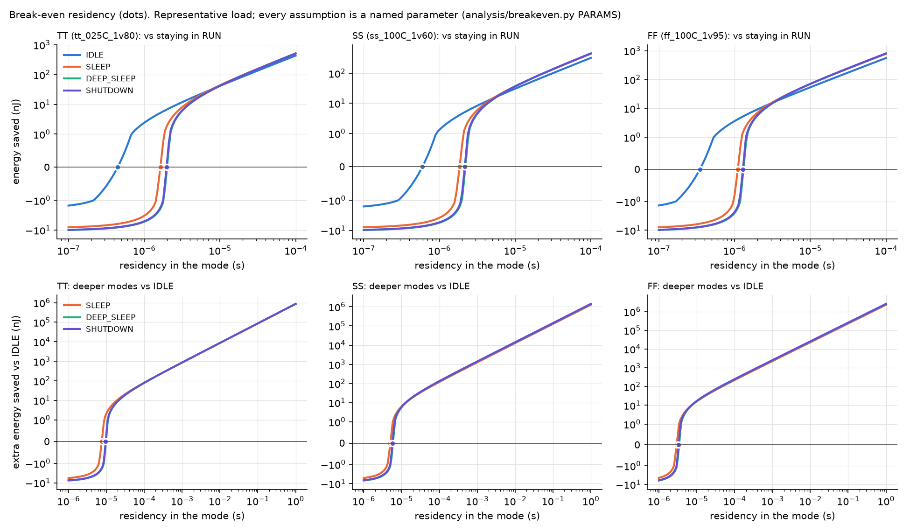

# Power analysis — when does each low-power mode pay off?

`analysis/breakeven.py` → `results/power/breakeven.json` and `results/plots/breakeven.png`. Every table
below is printed from those files; every assumption is a named parameter in `PARAMS` at the top of
the script (section 2).

## 1. The question
Entering a low-power mode costs energy and time:
- the power switches recharge the domain's capacitance;
- retention state is saved and restored;
- the PMU works through the sequence.

It saves power only while the domain stays in the mode. The **break-even residency** is the
shortest stay for which the mode saves energy overall:

    E_saved(t) = (P_before − P_mode) · t − E_overhead        t_be = E_overhead / (P_before − P_mode)

Two references are used:
- **vs RUN:** domains clocked but idle; the baseline when software has nothing to do.
- **vs IDLE:** clocks already gated. This asks whether the *deeper* modes are worth their extra
  overhead.

## 2. Inputs

**Measured (never typed):**
- **Representative load** (DECISIONS D-014, the owner's choice over the P1 ALU): the cell mix of
  LibreLane's `spm` example synthesised to `sky130_fd_sc_hd` (`results/power/rep_cells.json`).
- **Liberty values at each corner:** its average cell leakage, the flops' CLK pin capacitance,
  and the leakage of `sky130_fd_sc_hd__dlxtp_1`, the stand-in for a retention shadow latch.
  - TT = `tt_025C_1v80`, SS = `ss_100C_1v60`, FF = `ff_100C_1v95` (hot, worst leakage).
- **Mode entry and exit time**, measured in simulation by `test_latency`
  (`results/sim/icarus_latency.json`) at the reset delay registers, with model latencies of 2
  cycles for the Q-Channel device and 4 for the switches.
- **PMU power:** 3.72 mW from the post-route LibreLane run (OpenSTA, default activity,
  `results/flow/metrics.json`).

**Assumptions** (`PARAMS`; change them and rerun):

| Parameter | Value | Meaning |
|---|---|---|
| `F_CLK_MHZ` | 50 | domain and PMU clock (the PMU closes at 20 ns, D-016) |
| `N_CELLS` | CPU 20000, DSP 30000, PERI 10000 | representative domain sizes |
| `FLOP_FRACTION` | 0.15 | flops per cell (spm is 1/3 flops, not CPU-like) |
| `CLK_TREE_FACTOR` | 2.0 | clock-tree capacitance / total flop CLK pin capacitance |
| `N_RET_BITS` | CPU 1024, DSP 512, PERI 0 | retained bits |
| `C_PER_CELL_FF` | 5 fF | capacitance recharged per cell at power-up |
| `E_RET_PER_BIT_FJ` | 20 fJ | save + restore energy per retained bit |
| `SWITCH_OFF_LEAK_FRACTION` | 0.02 | leakage left in a switched-off domain |
| `CLK_GATED_RESIDUAL` | 0 | clock power left in a gated domain |

**Model:**
- **Domain power in each state:**
  - ON = leakage + clock power (C·V²·f);
  - CLK_GATED = leakage;
  - RET = switch-off leakage + retention latch leakage;
  - OFF = switch-off leakage.
- **Overhead per enter + exit:** switch recharge C·V² for each domain switched off, plus retention
  energy, plus PMU power × transition time.
- **The PMU term is an upper bound.** The PMU is always on and clocked in every mode, so most of its
  power is paid regardless of mode.

## 3. Results

**Measured transition times:**

| Mode | Entry (cycles) | Exit (cycles) | Exit latency at 50 MHz |
|---|---|---|---|
| IDLE | 13 | 13 | 260 ns |
| SLEEP | 33 | 70 | 1400 ns |
| DEEP_SLEEP | 33 | 94 | 1880 ns |
| SHUTDOWN | 31 | 94 | 1880 ns |

**Power in each mode** (P_run_idle = all domains ON and idle):

| Corner | P_run_idle | avg leakage per cell | IDLE | SLEEP | DEEP_SLEEP | SHUTDOWN |
|---|---|---|---|---|---|---|
| TT (tt_025C_1v80) | 5.21 mW | 0.00844 nW | 869 µW | 0.105 µW | 0.0183 µW | 0.0101 µW |
| SS (ss_100C_1v60) | 4.68 mW | 13 nW | 1.43e+03 µW | 162 µW | 28.5 µW | 15.5 µW |
| FF (ff_100C_1v95) | 8.16 mW | 24.5 nW | 2.59e+03 µW | 307 µW | 54.2 µW | 29.5 µW |

**Break-even residency:**

| Corner | Break-even vs RUN: IDLE | SLEEP | DEEP_SLEEP | SHUTDOWN | Break-even vs IDLE: SLEEP | DEEP_SLEEP | SHUTDOWN |
|---|---|---|---|---|---|---|---|
| TT | 0.446 µs | 1.63 µs | 2 µs | 1.97 µs | 7.56 µs | 9.79 µs | 9.6 µs |
| SS | 0.596 µs | 1.85 µs | 2.2 µs | 2.16 µs | 5.06 µs | 5.94 µs | 5.77 µs |
| FF | 0.348 µs | 1.1 µs | 1.31 µs | 1.29 µs | 2.95 µs | 3.43 µs | 3.33 µs |

**Overhead breakdown at TT:**

| TT overhead per enter+exit | IDLE | SLEEP | DEEP_SLEEP | SHUTDOWN |
|---|---|---|---|---|
| power switches (C·V²) | 0 nJ | 0.81 nJ | 0.972 nJ | 0.972 nJ |
| retention save+restore | 0 nJ | 0.0307 nJ | 0.0205 nJ | 0 nJ |
| PMU (upper bound) | 1.94 nJ | 7.67 nJ | 9.46 nJ | 9.31 nJ |
| total | 1.94 nJ | 8.51 nJ | 10.5 nJ | 10.3 nJ |

## 4. What the numbers say
- **Gating the clock is almost free and pays off within about half a microsecond.** At 50 MHz the
  clock tree is the dominant idle power; IDLE removes it for CPU and DSP for about 2 nJ of overhead.
- **Leakage depends enormously on the corner.** The average cell leaks 0.00844 nW at TT
  (25 °C) but 24.5 nW at hot FF (100 °C), about 3000× more.
  - At TT, sky130's leakage is so small that SHUTDOWN saves only nanowatts more than SLEEP.
  - At 100 °C power gating matters.
- **The overhead is dominated by the PMU term:** 7.67 of 8.51 nJ for SLEEP at TT. Since that term
  is an upper bound, the real break-even times are shorter than shown.

## 5. Recommended mode-selection policy

The best mode for an expected idle time (maximum energy saved, `policy` in the JSON):

| Corner | Best mode by expected idle time |
|---|---|
| TT | from 1e-07 s: RUN (stay); from 4.47e-07 s: IDLE; from 7.94e-06 s: SLEEP; from 0.02 s: SHUTDOWN |
| SS | from 1e-07 s: RUN (stay); from 6.31e-07 s: IDLE; from 5.62e-06 s: SLEEP; from 1.26e-05 s: SHUTDOWN |
| FF | from 1e-07 s: RUN (stay); from 3.55e-07 s: IDLE; from 3.16e-06 s: SLEEP; from 7.08e-06 s: SHUTDOWN |

**For software:**
1. **Idle shorter than about 0.5 µs:** stay in RUN.
2. **Idle of microseconds:** IDLE. Exit takes 13 cycles (260 ns).
3. **Idle beyond about 8 µs (TT) or 3 µs (hot):** SLEEP. Exit takes 1.4 µs, and CPU/DSP state is
   kept.
4. **Long idle:** SHUTDOWN wins on energy beyond 0.02 s at TT, but already beyond about 7 µs when
   hot. **It discards CPU state.** This model gives that loss no cost; in a real system the
   re-initialisation would. Without that cost DEEP_SLEEP never wins here, and with a re-init cost
   DEEP_SLEEP (CPU retained) becomes the choice for long idle. The policy should therefore use
   DEEP_SLEEP unless the CPU state can be discarded.
5. **Temperature-aware policy:** the crossovers move by orders of magnitude between 25 °C and
   100 °C, so a PMU driver can read a temperature sensor and pick thresholds per range.

## 6. Limits
- **Representative load, not a real CPU/DSP/PERI.** The sizes and capacitances are assumptions.
- **Clock power is modelled as C·V²·f** of flop clock pins times a tree factor, not from a real
  clock tree.
- **PMU power is OpenSTA default activity** (not annotated), and is used as an upper bound.
- **Not modelled:** software re-initialisation after OFF, and the energy of the domain's own
  activity during the transition.
- **No silicon,** and no measured switch characteristics.
